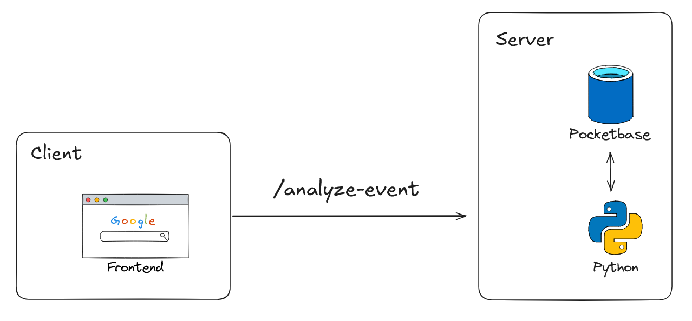
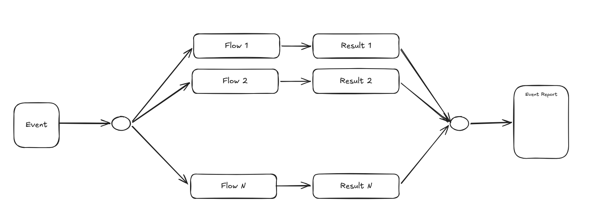

# Overview

## Frontend
An authentication gate restores the backend-managed HttpOnly session before
mounting the workspace. Logged-out users see an Editorial email/password form;
public registration adds password confirmation and signs in immediately. Session
outages show retry feedback. Logout/session expiry clear workspace state and abort
active frontend requests. Search and per-user retrieval remain future work.
TypeScript React homepage with an event textbox, analysis submission, and a
search input (search results are not implemented). The browser calls
`POST /api/analyze-event/stream`; the development/preview proxy forwards this to the
backend's `/analyze-event/stream` using `VITE_API_URL`. Production requires the same proxy
rewrite. Shared colors are configurable in `frontend/src/colors.css`.
All three screens use the approved Editorial design: ivory surfaces, terracotta
accents, serif headings, thin borders and a persistent header with search and Sidor
navigation. Crimson Pro and Switzer load from font services with local fallbacks.
The top-right menu switches between Hem, Status and Sammanfattning. Status is
available after submission; Sammanfattning requires a successful analysis.
Navigation preserves the current analysis and any active request. Returning Home
allows a replacement submission after processing finishes; only one analysis is
kept in memory. Completion opens the summary automatically only when Status is
selected, and completed Status remains accessible through the menu.

Submission immediately opens a status screen with registry-ordered expandable
workflow rows in one scrolling panel. Queued rows are greyed out, the current row
shows a subtle activity pulse and visible status text; completed rows show a checkmark with predicted tags. Only
completed rows expand, showing matched categories and verified supporting quotes.
A thin progress bar and completed/total count below the workflow list disappear on successful completion;
failures retain partial results and mark unrun workflows. Successful terminal
confirmation opens a summary showing unchanged original input on the left and
shared expandable workflow widgets on the right in a second content column.
Collapsed groups show their category names. Ny analys clears the composer and
focuses it while retaining completed results in the menu until a new submission.
Exact supporting quotes highlight all
occurrences; overlapping passages retain all associations.
Each workflow header has an unlabeled highlight switch, enabled by default and
available while collapsed. Disabled workflows leave other overlapping colors intact.
Activating a result quote scrolls its first occurrence to roughly 25% down the text
viewport, within scroll limits, even when its workflow highlights are off.
Hover/focus connects passages and workflows in both directions; click/tap pins selection, Escape clears
it. Text/results scroll independently and stack on mobile. State is in memory only.
The title text is initially absent, with its heading area reserved to keep other
widgets in place. A background title step replaces the former UUID
heading once finished; both analysis and summary screens use the generated title.
It has no status row or contribution to category progress.

## Backend
FastAPI exposes `POST /analyze-event`, accepting JSON with a non-empty `text`
string. It trims the text and currently returns
`{"status":"ok","title":"Händelserubrik","results":{"risks":[],"reach":[],"service":[],"properties":[],"protection":[]}}`.
Each workflow's list may contain zero, one, or multiple matches, each with `ID`
and display `name`. Invalid text returns HTTP 422.
Successful responses also include `embedding` and `embedding_error` fields.

The lifespan loads one generation runtime per server process into
`app.state.runtime`. `SERVING_ENGINE=transformers|vllm` defaults to Transformers;
`MODEL_ID` explicitly selects a Hugging Face model or local directory.
`MODEL_DEVICE=auto|cpu|cuda` selects the Transformers device. `/health` reports
the selected `serving_engine` alongside existing model metadata.
When CUDA is selected, `from_pretrained()` places the entire LLM directly on
`cuda:0` using a fixed device map, without a later `.to()` call. The CUDA
dependency profile includes Accelerate. DEBUG weights timing includes CUDA
placement and synchronization; CPU retains a separate device-placement stage.
Each server worker loads its own model. Windows/Linux CPU and Linux-only CUDA
13.0 profiles are managed with uv extras; CUDA includes both serving engines.
Use one Uvicorn worker; see [backend setup](backend/README.md).

vLLM uses an embedded async Python engine, with internal worker processes and no
additional HTTP service. It requires Linux/CUDA and rejects explicit CPU selection.
For NVIDIA's Gemma 4 NVFP4 checkpoint it automatically detects saved quantization.
The engine runs on one GPU with TP=1, one simultaneous sequence, and 12,288 tokens
of context. `VLLM_GPU_MEMORY_UTILIZATION` defaults to 0.70 and accepts finite values
in (0, 1]. EmbeddingGemma loads first so its resident GPU memory is visible to
vLLM. Worker creation defaults to spawn, avoiding forks after CUDA initialization.
Workflow threads bridge synchronous generation to the engine's application event
loop, submitting chat-template token IDs with thinking disabled and greedy sampling.
The existing inference lock serializes both engines. Shutdown aborts active vLLM
requests and stops its workers; startup failures release initialized resources.
Spark ARM64 dependency resolution and mocked tests do not verify NVFP4 kernels
or real-model classification quality.

Startup additionally loads text-only `google/embeddinggemma-2` using Transformers
5.19+, with audio and vision towers disabled, onto the same resolved device as
the LLM. Both models are required for startup. Embeddings use bfloat16 on
compatible CUDA hardware, otherwise float32. INFO logs record embedding model
load start and completion with duration, model ID, device, and dtype. DEBUG logs
record full/embedded token counts, truncation, embedding duration, and status;
CUDA timing synchronization is enabled only at DEBUG. Input text and vectors
are not logged.

`POST /embed-event` accepts the same text payload and returns a normalized
768-dimensional document embedding with model/task/dimension metadata, token
counts, and a truncation flag. The document prefix is `title: none | text: `;
no generated title is needed. Inputs are right-truncated to 8192 tokens including
prefix and special tokens. Attention-mask-aware mean pooling of projected token
representations and L2 normalization run in float32. Invalid vectors or inference
failures return 502. Query and other embedding tasks remain future work.

Both analysis endpoints submit embedding work before title generation to a
lifespan-managed single-worker executor. Its separate model lock allows overlap
with LLM inference while serializing embeddings. JSON responses and the existing
`analysis_completed` stream payload return the vector only at completion, with
`embedding_error: null`. Embedding failures preserve successful classification
with `embedding: null` and a structured 502 embedding error. Analysis failures
retain existing terminal behavior. Queued embedding work is cancelled on failure
or stream closure; running inference may finish with its result discarded.
Shutdown waits for active embedding work before releasing the runtimes.
The frontend accepts but does not retain these additional fields. No vector
persistence, related-event search, clustering, or graph storage is implemented.

`workflows.py` defines independent workflow functions and the `WORKFLOWS` registry.
A fixed `generate_title` step outside the registry runs before categorization,
using a separate Swedish prompt and the shared model. It generates a factual
title, strips surrounding quotes/whitespace and validates 1–10 words using Pydantic,
without truncation. Overlong titles use the fallback. Generation allows
64 output tokens. Inference failure or unusable output logs a warning and falls
back to `Händelseanalys` without retrying; 413/503 errors still stop analysis.
The risk, reach, service, properties, and protection workflows each use their own Swedish system prompt
and the matching category file in `backend/schemas/`. Each evaluates all of its
IDs and descriptions in one Gemma generation call, reusing the same processor and
model instance. Properties selects supported characteristics of the event's
development; assessment examples guide category selection without adding output
fields. Protection selects affected or explicitly threatened protection values.
Both use the existing category and evidence result format. The registry runs
risks, reach, service, properties, then protection and combines their results. Definitions
are validated once at startup; returned IDs are validated and mapped to display
names. Each categorization call also returns supporting quotes; only nonblank exact
substrings are retained and deduplicated. Invalid evidence is logged and omitted,
while valid categories remain available. Quote presence does not establish factual
or classification accuracy. A shared runtime lock serializes model access across requests and workflows.
Inputs exceeding 8192 tokens return HTTP 413; invalid model output or inference
failures return HTTP 502; unsupported model runtimes return HTTP 503.

`POST /analyze-event/stream` uses the same validation and execution but streams
`analysis_started`, `title_completed`, `workflow_started`, `workflow_completed`, and terminal
`analysis_completed` or `workflow_failed` events. Streaming inference runs in a
worker thread; errors after headers are sent are stream events. The frontend consumes
these updates through fetch. Production proxies must avoid buffering and allow
long inference timeouts. Stream matches include `evidence: string[]`; the original
JSON endpoint excludes evidence and adds a top-level title. Categorization allows 4096
output tokens to accommodate quotes, keeping the existing 8192 input-token limit.

Each validated request keeps a fresh UUID v4 in logs and the `X-Analysis-ID`
header, also included as `analysis_id` in stream metadata. Titles are display
metadata and do not replace this identifier. UUIDs, titles, trimmed original text,
and partial workflow predictions including evidence are persisted to PocketBase
using the verified user's refreshed auth token on each write. No backend superuser
token is configured. A shared HTTP client without default authorization connects to
`http://127.0.0.1:8090` by default, probes health at startup and on `/health`, and
closes after embedding workers at shutdown. PocketBase outages do not stop startup
or model health. Inference endpoints require a users session verified through
PocketBase; verification outages return 503. Health exposes separate availability
via `pocketbase_available`; write permissions are checked per user/request rather
than claimed by a public readiness flag. Auth login/register/session/logout endpoints
proxy PocketBase and use HttpOnly SameSite=Lax cookies, seven-day sessions,
configurable Secure cookies, and an exact Origin allowlist for state-changing requests.
New analysis records contain the verified `created_by` user relation.
Registration is forwarded without authentication under the users create rule.
PocketBase must remain private: the Go server rejects non-loopback listener IPs
and direct HTTPS mode, Python accepts only a loopback HTTP PocketBase URL, and
the public same-origin proxy exposes only frontend/Python. User-token result
writes rely on this isolation; local callers with that token share its permissions.
Writes are best effort, with INFO success logs and warnings on failure; failed
creates are not retried and failed final updates have no durable retry queue.

The evidence-linked summary and LLM title generation milestones are implemented.
A sidebar to switch event analyses remains future work. A versioned PocketBase Analysis collection exists,
and backend record writes are implemented;
the diagram below describes the intended architecture.

## Pocketbase
Data layer using Pocketbase, serving using Go. 

Collections
- users (default auth collection reused; required unique email, password login,
  minimum eight-character passwords and seven-day auth tokens; registration
  allowed, other record APIs locked)
- Events (event_id, group_id: nullable, text)
- Analysis (`analysis_id`: unique backend UUID v4, `status`: Processing/Failed/Complete,
  optional single `created_by` relation to users, indexed with created; legacy
  records remain unattributed and user deletion does not cascade-delete analyses,
  independent `embedding_status`: Processing/Failed/Complete, required `original_text`,
  `title`, `predictions`: workflow-keyed JSON including evidence, `error`: failure JSON,
  automatic `created`/`updated` timestamps, optional `finished_at` for the category
  analysis terminal time). Owner-attributed creation/update is allowed; creator,
  UUID and source text cannot be changed through the API. Reads/deletes stay locked.
  Backend persistence marks Failed if any category workflow fails and retains
  completed predictions; embedding failures are tracked separately. See
  [PocketBase schema and lifecycle](pocketbase/README.md).
